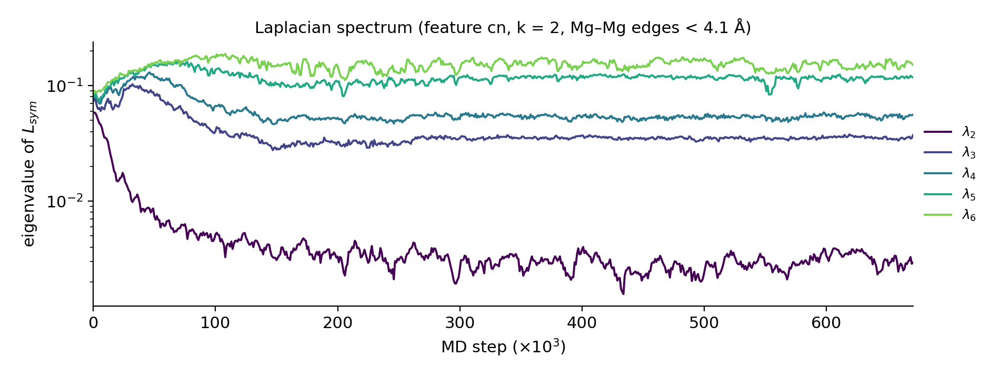
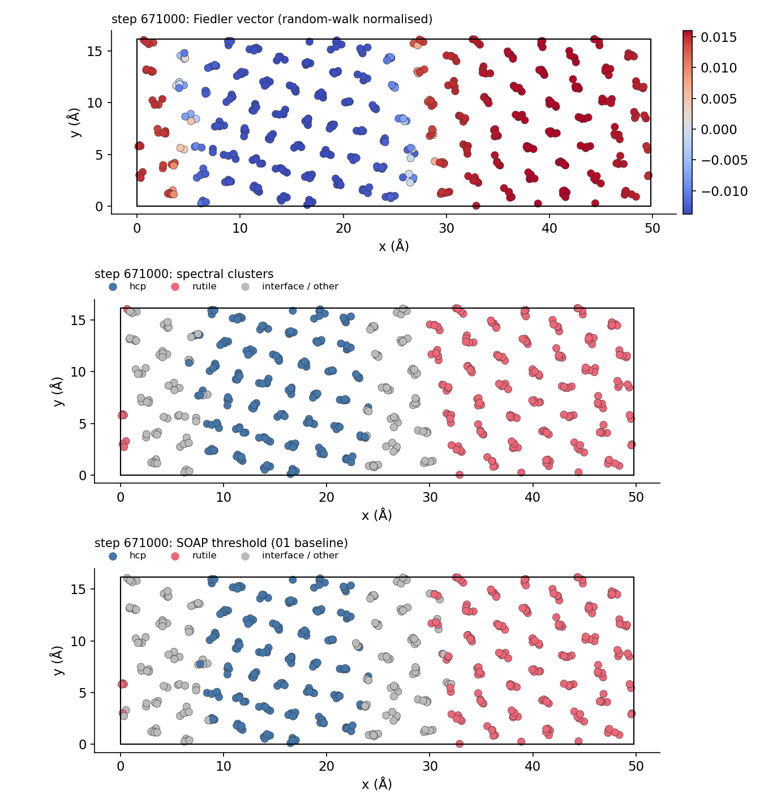
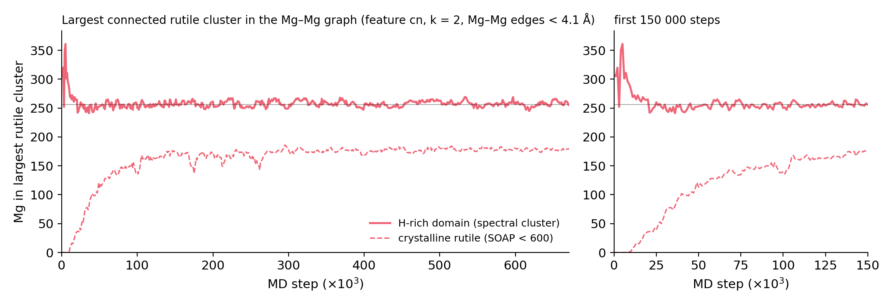

# 02 — Graph-Laplacian (spectral) clustering of the Mg / MgH₂ separation

First pass (2026-10-24) of §5.1 of the main [README](../README.md), run on the trajectory in
`../01_structure_phase_transition/soap.2.md.064.diff.extxyz` (Mg₅₁₂H₅₁₂, 672 frames, steps 0–671 000).

**Run:** `python graph_laplacian_clustering.py --feature cn` (or `--feature soap`); conda env `PEM`
(numpy, scipy, matplotlib, imageio-ffmpeg; ~1 min + ~3 min for the movie). Outputs `glc_<feature>.csv`,
`glc_<feature>_{spectrum,fractions,nucleus,final}.png` and **`glc_<feature>.mp4`** (atoms seen along z, Mg coloured
hcp / rutile / interface by the spectral clustering, H small yellow; below: phase fractions and λ₂, λ₃ vs step with a
time cursor; title shows λ₃/λ₂). Use `--no-movie` to skip the movie, and `--stride 2` for a shorter one. Only `glc_cn.mp4` (20 MB) is kept.

## Method

Per saved frame, Mg atoms only:

1. **Graph (radius graph on the 3-torus):** edge i–j if the Mg–Mg minimum-image distance < 4.1 Å
   (first minimum of the Mg–Mg pair-distance histogram, RDF).
2. **Node feature, averaged over a centred 5-frame window:**
   `cn` = Mg–H coordination number (number of H within 2.6 Å, the first minimum of the Mg–H RDF; ≈ 0 in hcp
   Mg, 6 in rutile MgH₂), or `soap` = (log d_hcp, log d_rutile) from the stored SOAP distances.
3. **Edge weights (Gaussian kernel):** w_ij = exp(−|f_i − f_j|² / 2σ²), with a fixed σ (1 H for `cn`, 0.5 log units
   for `soap`) so that weights mean the same thing in every frame.
4. **Spectral clustering:** normalised Laplacian L = I − D^{−1/2} W D^{−1/2}, the eigenvectors of the k smallest
   eigenvalues, rows normalised (Ng–Jordan–Weiss), k-means with 10 restarts. Clusters are named by mean CN
   (low = hcp, high = rutile).
5. **Interface = boundary nodes of the cut:** Mg with at least one graph neighbour in the other cluster.
6. **Nucleus = connected components** in the Mg–Mg graph of (a) the spectral rutile cluster (an **H-rich
   domain**: a composition label) and (b) Mg labelled rutile by the 01 SOAP threshold (**crystalline rutile
   order**: a structure label).

## Results

| Quantity (last 20 % of frames) | `cn` feature | `soap` feature |
|---|---|---|
| Eigengap λ₃/λ₂ (median) | **11.7** | 7.7 |
| Two-cluster split hcp / rutile | **0.499 / 0.501** | 0.608 / 0.392 |
| hcp / rutile / interface (boundary nodes) | 0.371 / 0.381 / 0.248 | 0.491 / 0.276 / 0.233 |
| Mean CN of hcp / rutile / interface | 0.08 / 6.16 / 3.36 | 0.41 / 6.14 / 5.62 |
| Per-atom agreement with the 01 SOAP threshold | 0.938 | 0.782 |
| Per-atom agreement with the CN threshold (≤ 1 / ≥ 4) | 0.836 | 0.724 |

1. **The spectrum chooses k = 2.** One eigenvalue (λ₂) separates from the rest, so the data contain two domains,
   not three. With k = 3, k-means cut the rutile slab in half, because a thin interface layer is not a
   well-connected cluster. Hence k = 2, with the interface defined as the cut boundary.
   
2. **λ₂ is a usable order parameter (a scalar that tracks the separation).** It falls from 0.058 at step 0 to
   ~0.003 (median, last 20 %). The eigengap λ₃/λ₂ is 1.3 at step 0 and first exceeds 2, 5 and 10 at steps 11 000,
   25 000 and 32 000. Before about step 25 000 there is no gap, so the spectral labels in those frames are not meaningful.
3. **The `cn` feature reproduces the expected 50 / 50 split.** This is a consistency check, not an independent
   result. If every H sits in a rutile site (3 Mg neighbours each), then 512 H × 3 = 1536 = 256 Mg × 6, so 256 of
   the 512 Mg must be rutile. The Fiedler cut puts the interfaces in the two grey bands of the 01 snapshots.
   
4. **The `soap` feature misplaces the cut.** It puts the H-rich, poorly crystalline band at x ≈ 0–8 Å together
   with hcp (that "interface" has mean CN 5.6), so it gives 0.61 / 0.39. The stored SOAP distances confuse
   "far from perfect rutile" with "not hydride". The composition feature is more reliable here.
5. **Composition separates first, crystal order follows (a two-step picture).**
   
   - The H-rich domain is one connected cluster from step 0: about 250–360 Mg in the first 10 frames, then
     ~256 throughout. At H:Mg = 1 with random positions, H-rich Mg already percolate (form a box-spanning
     connected component), so this label has no nucleus to find.
   - The largest **crystalline**-rutile cluster first reaches 10 Mg at step 12 000, 50 at 27 000 and 100 at
     40 000, and levels off at ~175–180 Mg after ~140 000 steps.
   - There is no flat waiting period before growth. This fits barrier-free separation (main README §4, caveat 1),
     not classical nucleation. The tools work, but this trajectory has no nucleation barrier to measure.

## Limitations / next

- The boundary-node interface is about two atomic layers thick (25 % of Mg), while the CN threshold gives about 9 %.
  A finer definition could use the value of the Fiedler vector (e.g. |φ| below a threshold) or the second-neighbour
  shell only.
- Spectral clustering always returns k clusters. Report labels only where the eigengap is open.
- The time axis is MD steps (time-step length not yet recorded).
- For real nucleation statistics, run (b) on trajectories that start from a metastable state (hcp Mg
  supersaturated with H). Then the distribution of n_max and its waiting time give the critical size n\*
  (main README §5.1, §5.4).
