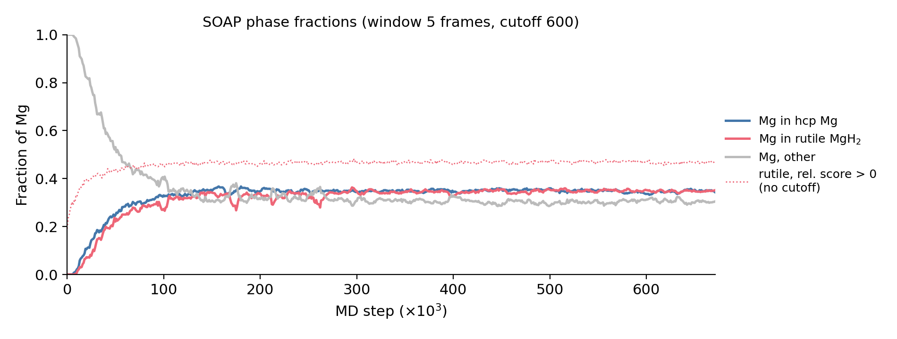
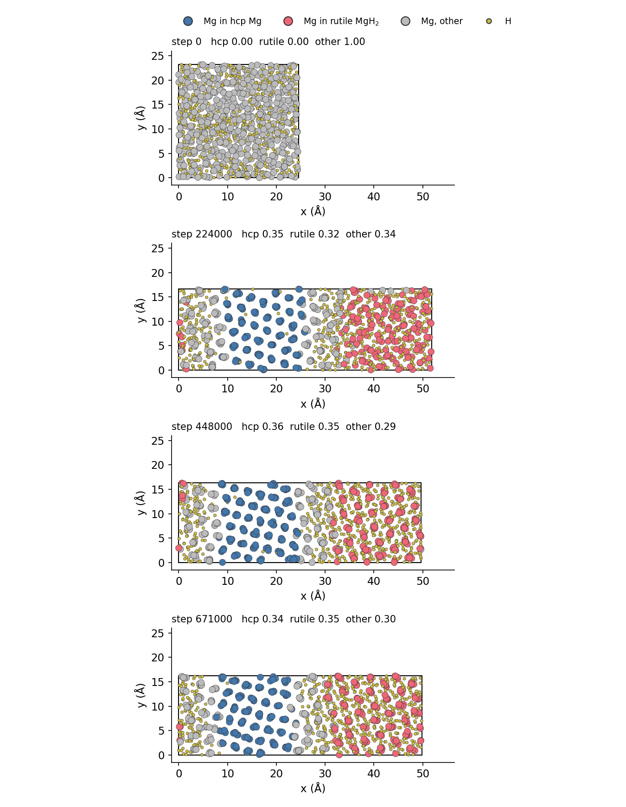

# Phase Transformation & Nucleation in Mg / MgH₂ — a math-tools collaboration

**People:** Keerati Keeratikarn (computational chemistry / MLIP + MD) · Nan (applied mathematics / computer science)
**Parent project:** `Hydrogen_Storage-` (MACE fine-tuning for MgH₂; folder `07_structure_phase_transition` copied here on 2026-10-24 as `01_structure_phase_transition`)
**Context paper (draft):** *Hydrogen Absorption and Desorption in Mg/MgH₂ via Hybrid Monte Carlo/Molecular Dynamics with a
Fine-Tuned Machine Learning Interatomic Potential* (Kaewkwan, Keeratikarn, … Suthirakun; `manuscript-mgh2-RK.docx`)

> **How to read this file.** Physics / chemistry terms are written as we use them; the nearest term from
> applied math / CS follows in parentheses, e.g. *molecular dynamics (MD) (numerical ODE integration of
> Newton's equations — a deterministic dynamical system, plus a stochastic thermostat)*. There is a full
> glossary in §7.

---

## 1. The question in one paragraph

Magnesium stores hydrogen by turning from a metal, **Mg in the hcp structure**, into a hydride, **MgH₂ in the
rutile (α) structure**: Mg + H₂ ⇌ MgH₂. The reaction is a **first-order phase transformation (a discontinuous
change in the system's state: the order parameter jumps, two states coexist across an interface)**. The new
phase does not appear everywhere at once; it starts from small local seeds — **nucleation (the birth of a
small, stable cluster of the new phase; a rare event that must cross an energy barrier)** — that then
**grow (the cluster boundary moves)**. We have atom-by-atom trajectories of this process from simulation. We
want mathematical tools that answer:

1. **Which atoms belong to which phase at each time?** (per-node classification / clustering on a time-varying graph)
2. **When and where does a nucleus first appear, and how big must it be to survive?** (detecting the onset of a
   persistent connected component; its critical size)
3. **What does the transformation look like at a coarser scale?** (coarse-graining: atoms → a continuous field / a
   smaller graph whose dynamics we can model)

---

## 2. The physical system (what the atoms are doing)

| Phase | Crystal structure | What it looks like locally | Math picture |
|---|---|---|---|
| **Mg (hcp)** | hexagonal close-packed metal, *P6₃/mmc* | each Mg has 12 Mg neighbours, **0 H neighbours** | a dense periodic point set (lattice with a 2-point basis); node degree 12 in the Mg–Mg graph |
| **α-MgH₂ (rutile)** | tetragonal, *P4₂/mnm* — the stable hydride at normal T, P | each Mg sits inside an **octahedron of 6 H** (MgH₆); octahedra share edges into straight chains | a bipartite Mg–H graph where every Mg node has degree ≈ 6 |
| β-MgH₂ | cubic (fluorite-type) — **only at high pressure** | Mg with 8 H | — |
| γ-MgH₂ | orthorhombic (α-PbO₂-type) — high pressure / ball milling | MgH₆ octahedra in **zig-zag** chains | same degree as α, different chain geometry (Mg–Mg–Mg angle ≠ 180°) |

⚠ **Naming:** "α" is the **rutile (tetragonal)** phase, not cubic. The cubic hydride is β. At the conditions we
simulate (600–800 K, ~1 bar) the relevant transformation is **hcp Mg ⇌ rutile α-MgH₂** (manuscript §Introduction).

Facts that matter for the math:

- **~30 % volume change** between Mg and MgH₂ → the simulation box changes shape over time (the domain of the
  point cloud is not fixed).
- The transformation is close to **topotactic (the Mg "skeleton" is roughly preserved; H atoms fill in around
  it; mostly a local deformation, not a global reshuffle)**. Experiments see a fixed orientation relation,
  Mg (0001) ∥ MgH₂ (110). So it is a good candidate for **graph-based** descriptions: the Mg network mostly
  keeps its connectivity while the H atoms rewire the Mg–H edges.
- **H is fast, Mg is slow.** In our trajectory the Mg mean-squared displacement (MSD) (variance of displacement
  of a random walk) levels off at ~153 Ų while H keeps diffusing (769 Ų at the end). Two time scales →
  think of H as the fast variable and the Mg structure as the slow variable.

---

## 3. How the data were made

**Potential energy (the "physics engine").** A **machine-learning interatomic potential, MLIP (a learned
function E(positions) → energy; forces = −∇E)**: the MACE-MH-1 foundation model, **fine-tuned (transfer
learning, LoRA adapters)** on DFT data of Mg–H structures from pure Mg to MgH₂ — see the parent repo.
MACE is itself an **equivariant message-passing graph neural network (GNN; atoms = nodes, neighbours within a
cutoff radius = edges; features are built from radial basis functions × spherical harmonics)** — remember this
for §5.3.

**Simulation methods** (manuscript §Computational details):

- **Molecular dynamics, MD (integrate m ẍ = −∇E(x) with a fixed time step, 1 fs, plus a thermostat that keeps the
  temperature constant = a stochastic perturbation)**. Run in the **NPT ensemble (constant number of atoms,
  pressure, temperature; the box shape is an extra dynamical variable — Berendsen barostat, anisotropic)**.
- **Hybrid Monte Carlo/MD in the semi-grand-canonical ensemble μ_H N_Mg P T (a Markov chain that inserts or
  deletes H atoms with Metropolis–Hastings acceptance, alternating with MD segments)**: 100 MC steps + 0.1 ps
  MD per cycle. This produces H **absorption (Mg → MgH₂)** and **desorption (MgH₂ → Mg)** trajectories.
- Finding in the draft: starting from a structure with H spread evenly, the system **separates into a Mg zone and an
  MgH₂ zone** (phase separation). The trajectory in `01_structure_phase_transition` shows exactly this.

---

## 4. What is in `01_structure_phase_transition/` (the data Nan can start on)

| File | What it is |
|---|---|
| `soap.2.md.064.diff.extxyz` (70 MB) | **The trajectory.** 672 frames (a time series of point clouds), 1024 atoms each: **Mg₅₁₂H₅₁₂** (H:Mg = 1, i.e. half-way between Mg and MgH₂). Steps 0 → 671 000, one frame per 1000 MD steps. Per atom: `species`, `pos` (x, y, z in Å), `dist_hcp`, `dist_rutile`, `phase_id`. Periodic box (`Lattice=`, `pbc="T T T"`) — the domain is a **3-torus (periodic boundary conditions)**. |
| `plot_phase_movie.py` | Reads the trajectory, classifies each Mg, writes the movie, figures and CSV below. |
| `….phase.mp4` | Movie: atoms seen along z, coloured by class, + phase fractions vs time. |
| `….phase_fraction.png` | Fraction of Mg in each class vs MD step. |
| `….phase_snapshots.png` | Four frames: step 0, 224 000, 448 000, 671 000. |
| `….phase_classes.csv` | Per frame: counts of hcp / rutile / other Mg, and the coordination-number check. |

**Per-atom columns.**

- `dist_hcp`, `dist_rutile` — distance of the atom's **SOAP descriptor (a feature vector describing the atom's
  neighbourhood, invariant to rotation/translation/permutation of neighbours)** to the SOAP vector of a
  perfect-hcp Mg and a perfect-rutile Mg reference. Small = looks like that phase. Defined for Mg only (NaN for H).
  Unnormalised (range ≈ 23–6243).
- `phase_id` — despite the header (`0 unknown, 1 hcp, 2 rutile`), it is **not a label**: it equals the continuous
  score (d_hcp − d_rut)/(d_hcp + d_rut) ∈ [−0.99, 0.99]; H atoms get 0.

**Current classification (baseline to beat).** For each Mg: (1) average `dist_hcp` and `dist_rutile` over a centred
window of 5 frames (a moving-average low-pass filter in time); (2) label **hcp** if d_hcp < 600 and d_hcp < d_rut,
**rutile** if d_rut < 600 and d_rut < d_hcp, else **other** (a nearest-centroid classifier with a rejection
threshold). Independent check: **coordination number CN (node degree in the Mg–H graph with edge cutoff
2.3 Å)** — hcp Mg should have CN ≈ 0, rutile Mg CN ≈ 6.

**Results so far.**



- Frame 0 is a random mixture: 100 % *other*. Fractions settle by ~120 000 steps (~120 ps if the step is 1 fs —
  still to confirm). First rutile-labelled Mg appears at step 8 000.
- Last 20 % of frames: **hcp 0.35, rutile 0.35, other 0.30** of all Mg. Mean CN per class: 0.05 (hcp), 5.57
  (rutile), 2.94 (other). Per-atom agreement SOAP class vs CN class: 0.76.
- The CN-only classes for the same frames are **0.45 (CN ≤ 1) / 0.48 (CN ≥ 4) / 0.07 (CN 2–3)** — close to the
  **lever rule (mass balance)** expectation for Mg₅₁₂H₅₁₂ → 256 Mg + 256 MgH₂, i.e. 0.5 / 0.5. So the SOAP
  threshold leaves too many atoms as *other*: a better classifier is an open, well-posed problem.
- The box stretches from 24.5 × 23.2 × 24.5 Å to 49.8 × 16.2 × 17.0 Å at ~constant volume: the system arranges
  itself into a **slab geometry (two flat interfaces perpendicular to x — this minimises interface area in a
  periodic box)**.



Blue = Mg in hcp, red = Mg in rutile, grey = other, small yellow = H.

**Run it:** `python plot_phase_movie.py [EXTXYZ] --window 5 --dcut 600 --cn-cut 2.3` (needs numpy, matplotlib,
imageio-ffmpeg; conda env `PEM`). Loading in Python: `ase.io.read(path, index=":")` gives a list of `Atoms`
(positions `(1024, 3)`, cell `(3, 3)`, per-atom arrays in `atoms.arrays`).

**Caveats on this trajectory.**

1. It starts from a **random (disordered) configuration**, not from hcp Mg with H being added. Hydride clusters
   appear almost immediately with no waiting period → this looks more like **spinodal decomposition
   (instability: any small fluctuation grows, no barrier)** or barrier-free ordering than like classical
   **nucleation (metastability: a barrier, an induction time, a critical size)**. To study nucleation proper we need
   runs that start from a *metastable* state — e.g. hcp Mg supersaturated with H, or the MC/MD absorption runs.
2. MD time step, temperature, barostat and SOAP settings (cutoff, n_max, l_max, σ, reference structures) for this
   file are not yet recorded. The x-axis is MD steps, not time.
3. H atoms have no class. Rutile vs hcp is decided only from the Mg side.

---

## 5. Math directions (proposals to discuss)

### 5.1 Graph Laplacian / spectral clustering to define the nucleus

*Physics question:* which Mg atoms form a connected region of the new phase, and when is that region a nucleus?

- **Graph per frame.** Nodes = atoms. Edges = pairs closer than a cutoff r_c, using the minimum-image distance on
  the torus (periodic boundaries). Natural choices: Mg–H bonds (r_c ≈ 2.3 Å), Mg–Mg neighbours (r_c ≈ 3.6 Å).
- **Edge weights** from local similarity: w_ij = exp(−‖s_i − s_j‖² / 2σ²) with s_i the SOAP vector (or simply
  the CN / local H fraction) → neighbouring atoms in the same environment are strongly linked; across an
  interface the weights drop.
- **Spectral clustering** on L = D − W (or the normalised L_sym): the **Fiedler vector** (eigenvector of the
  second-smallest eigenvalue) should cut the box at the Mg/MgH₂ interfaces; λ₂ measures how well separated the
  two phases are (a scalar order parameter vs time).
- **Nucleus = largest connected component of rutile-like Mg** (in the Mg–Mg graph restricted to rutile-labelled
  nodes). Track n_max(t), the number of components, and their sizes. In **classical nucleation theory, CNT
  (a model of the free energy of a cluster of n atoms: ΔG(n) = −n Δμ + γ A(n), bulk gain vs interface cost,
  A ∝ n^{2/3})** the cluster survives only above a **critical size n\***. From many trajectories, the
  distribution of n_max and the probability that a cluster of size n grows (committor (probability of reaching
  state B before A from a given state)) estimate n\*.
- Check: does the spectral cut agree with the CN classes and with the CSV? Does a graph-based label reduce the
  30 % *other* to something close to the ~7 % that CN suggests?

**First pass done → [`02_graph_laplacian_clustering/`](02_graph_laplacian_clustering/README.md)** (feature = Mg–H CN,
Mg–Mg edges < 4.1 Å):
- The **eigengap** (λ₃/λ₂ ≈ 12) shows **two domains (k = 2)**. The cut splits Mg 0.499 / 0.501 hcp / rutile, as
  required by H conservation. It agrees with the 01 SOAP labels for 94 % of atoms and puts the interfaces in the grey bands.
- **λ₂ (algebraic connectivity)** falls from 0.058 to ~0.003 as the system separates. This makes it a one-number
  order parameter. The eigengap opens between steps ~11 000 and ~32 000.
- **Two-step picture.** The H-rich domain spans the box from step 0 (it percolates; there is no nucleus to find),
  while the largest crystalline-rutile cluster grows steadily (10 → 50 → 100 Mg at steps 12 000 / 27 000 / 40 000;
  plateau ~180). There is no induction time, so in this run the process is barrier-free ordering, not classical
  nucleation.
- Using the SOAP distances as the feature is worse (0.61 / 0.39 split): they place the H-rich band at x ≈ 0–8 Å with hcp.

### 5.2 Coarse-graining (Mg ⇄ MgH₂, hcp ⇄ rutile)

*Physics question:* can we describe the transformation with a few collective variables or a continuous field
instead of 1024 atoms?

- **Field coarse-graining:** put a grid on the box, smooth per-atom quantities with a Gaussian kernel → fields
  c(x, t) = local H/Mg ratio (**concentration, a conserved order parameter**) and φ(x, t) = local rutile fraction
  (**structural order parameter, non-conserved**). These are the inputs of **phase-field models (PDEs: Cahn–Hilliard
  for c, Allen–Cahn for φ)**. One could fit the free-energy functional F[c, φ] from the data.
- **Graph coarsening:** collapse each MgH₆ octahedron or each Mg with its neighbours into a super-node (graph
  pooling / Kron reduction / spectral coarsening that preserves the low eigenvalues of L). Compare coarse graphs
  of hcp and rutile regions.
- **Collective variables (low-dimensional coordinates that capture the slow dynamics):** total rutile fraction,
  n_max, λ₂, box aspect ratio. Diffusion maps / PCA / time-lagged ICA on per-frame descriptors could reveal how
  many slow variables there really are.

### 5.3 Topological data analysis (TDA) on the atom graph

*Physics question:* do topological features (loops, cavities, number of components) change at the transition, and can they
mark a nucleus before a threshold-based label does?

**Keerati's idea:** do not grow the balls (the usual Vietoris–Rips / Čech filtration over the radius ε); instead **fix
the ball radius and let time move the atoms** — an edge is born when two atoms come within the fixed radius during MD.

Comments to sort out together:

- With a fixed radius, the complex changes **non-monotonically in time** (edges appear *and* disappear as atoms
  vibrate and H hops). Standard persistent homology needs a nested sequence. The tools for this are **zigzag
  persistence (Carlsson & de Silva 2010)** and, more simply, **CROCKER plots (Betti numbers β₀, β₁, β₂ drawn as a
  heat map over (radius, time); Topaz, Ziegelmeier & Halverson 2015)**. Fixing one radius = one row of the CROCKER plot.
- **Which radius?** At 600–800 K atoms vibrate by ~0.1–0.2 Å, so edges near the cutoff flicker every few fs.
  Choose r between the first and second neighbour shells of the radial distribution function (RDF) (histogram of
  pair distances) — e.g. Mg–H ≈ 2.3 Å, Mg–Mg ≈ 3.6 Å — and/or time-average over a window, as the current script does.
- **Expected signatures:** rutile has MgH₆ octahedra sharing edges along c (straight Mg–Mg–Mg chains at 180°);
  hcp has a different ring structure in the Mg–Mg graph. β₁ (independent loops) of the Mg–H complex should differ
  strongly between the two regions — compute persistence for the two perfect references first.
- **Local TDA** (persistence diagram of each atom's neighbourhood within ~6 Å) gives a per-atom topological
  descriptor that can go into the same classifier as SOAP.

**"Radial basis + spherical harmonics instead of the uniform ball."** This is exactly what **SOAP** is: each
neighbour is replaced by a Gaussian (a smooth ball), the neighbour density ρ_i(r) = Σ_j exp(−|r − r_ij|²/2σ²)
is expanded as Σ c_nlm g_n(r) Y_lm(r̂) (radial basis g_n × spherical harmonics Y_lm), and the rotation-invariant
**power spectrum** p_nn'l = Σ_m c_nlm c*_n'lm is the feature vector. The `dist_hcp` / `dist_rutile` columns in
our file are already distances in this space; **Steinhardt q₄, q₆ (bond-orientational order parameters)** are the
special case with a single shell and only l = 4, 6; MACE uses the same basis inside its message passing.
So the new direction is not the smooth basis itself but how to use it:

- a **filtration over the SOAP smoothing width σ** (multiscale), or a **kernel-weighted graph** with
  w_ij = SOAP kernel k(i, j) = (p_i · p_j)^ζ / normalisation, then Laplacian or persistence on that weighted graph;
- **persistence on the (time-averaged) density field ρ(x, t)** (sublevel-set filtration of a function on a
  grid) — this is TDA on the coarse-grained field from §5.2.

### 5.4 Can we see nucleation in an energy plot?

*Physics question:* does a plot of energy vs time mark the moment a nucleus forms?

**Short answer: it shows growth, not the nucleation event itself.** In addition, the trajectory file stores **no
energies** (only species, positions, `dist_hcp`, `dist_rutile`, `phase_id`; no energy, forces, stress or
temperature), so energies have to be recomputed first.

- **Which energy.** At constant pressure the relevant quantity is the **enthalpy H = E + PV (energy + pressure ×
  volume; the potential the NPT dynamics effectively lowers)**, not E alone.
- **Growth is visible.** When hundreds of Mg convert into ordered hcp Mg / rutile MgH₂, H drops clearly (ordering
  releases energy). In a classic nucleation run the curve is flat during the **induction time (waiting time before
  the rare event)**, then drops.
- **The nucleus itself is not visible at 1024 atoms.** A critical nucleus is probably tens of atoms → ~1–3 eV
  (order-of-magnitude guess, not measured). Thermal fluctuations of the total potential energy at 700 K are
  ≈ √(3N/2)·k_BT ≈ √1536 × 0.06 eV ≈ 2.4 eV (**signal-to-noise ≈ 1: the nucleation signal is buried in the noise of
  a sum of ~N random terms**). The drop appears only once the nucleus is already growing.
- **This trajectory** starts from a random mixture and rutile appears by step 8 000, so E(t) most likely falls
  steadily from step 0 with no induction time — consistent with barrier-free separation (§4 caveat 1). It cannot
  give a nucleation barrier.

**Energy-based analyses that would work:**

1. **Per-atom energy maps.** MACE writes the total energy as a sum of per-atom contributions (Eq. 1 of the
   manuscript; a node-level output of the GNN). Colouring atoms by their energy should highlight nuclei and
   interfaces as local patches → a second **node feature** next to SOAP for the graph clustering of §5.1. Caveat:
   the split of E into atoms is not physically unique (a model convention), but it is a useful descriptor.
2. **Free energy vs nucleus size, ΔG(n)** — the curve that actually defines nucleation: it rises to a maximum (the
   barrier) at the critical size n\* and falls beyond it (**a 1-D potential with a saddle; n is the reaction
   coordinate**). Three ways to get it:
   - **Cluster statistics:** from the size distribution P(n) of rutile clusters (connected components, §5.1),
     ΔG(n) = −k_BT ln P(n) (**Boltzmann inversion: probability → potential**). Valid only below n\*, and only in runs
     that start from a metastable state.
   - **Umbrella sampling / metadynamics** with the largest cluster size n_max as the **collective variable (the
     coordinate the simulation is biased along — importance sampling with a bias potential)**. Gives the full barrier.
   - **Seeding:** insert a rutile cluster of size n into H-supersaturated hcp Mg and check whether it grows or
     shrinks (**bisection on n for the 50 % growth probability**).

   The umbrella sampling in the manuscript is free energy vs **H concentration**, a different curve — not a
   nucleation barrier.
3. **Cheapest first step:** recompute E (and H = E + PV) for the 672 frames with the fine-tuned MACE model and
   plot it next to the phase-fraction curve. If the energy tracks the rutile fraction, the drop is the growth /
   separation. Needs from Keerati: which MACE model produced `soap.2.md.064`, and whether the original MD log or
   full-rate trajectory exists (the file keeps one frame per 1000 steps and has no T or P; a recomputed energy also
   differs slightly if the model is not the one used in the MD).

### 5.5 Suggested first steps

1. Read the trajectory; build the Mg–H and Mg–Mg graphs per frame (periodic distances); reproduce the CN numbers.
2. ~~Spectral clustering of frame 671 (end state) — does the Fiedler cut put the two interfaces in the grey bands at x ≈ 0–8 Å and ≈ 26–30 Å (last snapshot)?~~
   Done for all frames (`02_graph_laplacian_clustering/`): yes. Open points: a thinner interface definition, and
   features that combine composition and structure.
3. β₀/β₁ vs time at one fixed radius (CROCKER row) for the Mg–Mg and Mg–H complexes, plus persistence diagrams of
   perfect hcp and rutile cells as references.
4. ~~Largest rutile cluster n_max(t) over the first 150 frames~~ — done in `02_graph_laplacian_clustering/` (`glc_cn_nucleus.png`).
5. Energy vs time next to the phase fractions, plus per-atom energy maps (§5.4; Keerati to recompute with MACE).
6. Then ask for a trajectory that starts from a metastable state for true nucleation statistics and ΔG(n)
   (Keerati to provide).

---

## 6. Open questions (physics side, Keerati)

- MD time step, temperature, barostat, total time and SOAP settings for `soap.2.md.064`.
- Is the 2× stretching of the box along x physical (the slab arrangement) or a Berendsen-barostat effect?
- What is the H-rich *other* band at x ≈ 0–8 Å (a disordered interface, a γ-like phase, or thermal noise)?
- Absorption/desorption MC/MD trajectories (64-Mg cells, 600/700/800 K) as further data sets.
- Which MACE model produced `soap.2.md.064`, and is the original MD log (energy, T, P) or full-rate trajectory
  available? (needed for §5.4)

---

## 7. Glossary (physics/chemistry term → math/CS equivalent)

| Physics / chemistry | Meaning | Math / CS analogue |
|---|---|---|
| Atom, position r_i | point in ℝ³ with a type (Mg or H) | labelled point cloud; graph node |
| Periodic boundary conditions (PBC), unit cell, `Lattice` | the box repeats infinitely in all directions | the domain is a 3-torus; distances use the minimum image |
| Supercell | the simulated box made of repeated unit cells | finite sample of a periodic pattern |
| Crystal structure / phase (hcp, rutile) | a specific periodic arrangement of atoms | a lattice + basis; a class label |
| Polymorph (α, β, γ) | same chemical formula, different structure | different classes, same composition |
| Bond / neighbour | two atoms within a cutoff distance | edge in a radius (ε-) graph |
| Coordination number (CN) | number of neighbours of an atom | node degree |
| Radial distribution function (RDF, g(r)) | normalised histogram of pair distances | pair-distance distribution |
| Angular distribution function (ADF) | histogram of bond angles | distribution over triples of nodes |
| SOAP descriptor | smooth, rotation-invariant fingerprint of an atom's neighbourhood | feature embedding / kernel |
| Steinhardt q₄, q₆ | bond-orientational order parameters | rotation-invariant moments of spherical-harmonic expansions |
| Order parameter | scalar that is ~0 in one phase and non-zero in the other | indicator / feature that separates the classes |
| Phase transformation (first order) | discontinuous change between two phases that coexist | bistable system; switching between two attractors/basins |
| Nucleation | the formation of a small cluster of the new phase that must cross a barrier | rare event; barrier crossing in a double-well landscape |
| Critical nucleus n\* | the cluster size at the top of the barrier | saddle point of ΔG(n); 50 % committor |
| Growth | the cluster grows after nucleation | interface (front) propagation |
| Spinodal decomposition | separation without a barrier (unstable mixture) | linear instability; growth of unstable Fourier modes |
| Interface | boundary between two phases | graph cut / decision boundary |
| Topotactic transformation | the host skeleton is kept while guests enter/leave | structure-preserving deformation of a graph |
| Free energy G, chemical potential μ | the quantity the system minimises at constant T, P; μ = ∂G/∂N | objective / potential function; Lagrange multiplier on particle number |
| Enthalpy H = E + PV | energy plus pressure × volume; what drops when a phase forms at constant P | objective tracked along an NPT trajectory |
| Induction time | waiting time before a nucleus appears | first-passage time of a rare event |
| Collective variable, umbrella sampling, metadynamics | a chosen coordinate (e.g. n_max) and methods that bias the simulation along it to map ΔG | reaction coordinate; importance sampling with a bias potential |
| Lever rule | phase amounts follow from mass balance | linear constraint (convex combination) |
| Temperature T, k_BT | thermal noise strength | noise variance / inverse of β in exp(−βE) |
| Molecular dynamics (MD) | step-by-step simulation of Newton's equations | numerical ODE (velocity Verlet) + stochastic thermostat (Langevin-type SDE) |
| NPT ensemble, barostat | constant number of atoms, pressure, temperature; box shape is a variable | constrained sampling; box as an extra degree of freedom |
| Monte Carlo (MC), grand-canonical MC | random insert/delete/move steps accepted with Metropolis rule | Markov chain Monte Carlo (Metropolis–Hastings) |
| Time step, frame, trajectory | integration step; saved snapshot; the whole run | Δt; sample; time series of point clouds |
| Mean squared displacement (MSD) | ⟨|r(t) − r(0)|²⟩ | variance of a random walk; ∝ t for diffusion |
| DFT (density functional theory) | quantum-mechanical energy calculation (expensive, accurate) | ground-truth label generator |
| MLIP / MACE | ML model that predicts the DFT energy fast | equivariant GNN regressor E(x); forces by autodiff |
| Fine-tuning, LoRA | adapting a pretrained model to new data | transfer learning; low-rank adapter |
| Active learning (QbC, FPS) | choose new structures to label by model disagreement / diversity | query-by-committee; farthest-point sampling |
| Å (ångström) | 10⁻¹⁰ m; typical bond length 2–3.5 Å | unit of length |

---

## 8. Repository layout

```
PhaseTransfornation_Hydrogenstorage/
├── README.md                          ← this file
├── 01_structure_phase_transition/     ← copied from Hydrogen_Storage- (2026-10-24)
│   ├── plot_phase_movie.py
│   ├── soap.2.md.064.diff.extxyz      (70 MB — use Git LFS if this goes on GitHub)
│   ├── soap.2.md.064.diff.phase.mp4   (20 MB)
│   ├── soap.2.md.064.diff.phase_classes.csv
│   ├── soap.2.md.064.diff.phase_fraction.png
│   └── soap.2.md.064.diff.phase_snapshots.png
└── 02_graph_laplacian_clustering/     ← spectral clustering + rutile cluster sizes (§5.1)
    ├── README.md
    ├── graph_laplacian_clustering.py  (reads the 01 trajectory; reuses its reader)
    ├── glc_cn.csv, glc_cn_{spectrum,fractions,nucleus,final}.png      (CN feature, main result)
    └── glc_soap.csv, glc_soap_{spectrum,fractions,nucleus,final}.png  (SOAP feature, comparison)
```

**References to start from.** Bartók, Kondor & Csányi, *PRB* 87, 184115 (2013) — SOAP. Steinhardt, Nelson & Ronchetti,
*PRB* 28, 784 (1983) — q₄/q₆. Carlsson & de Silva, *Found. Comput. Math.* 10, 367 (2010) — zigzag persistence.
Topaz, Ziegelmeier & Halverson, *PLoS ONE* 10, e0126383 (2015) — CROCKER plots. von Luxburg, *Stat. Comput.* 17, 395
(2007) — spectral clustering tutorial. Batatia et al., *NeurIPS* 2022 — MACE.
